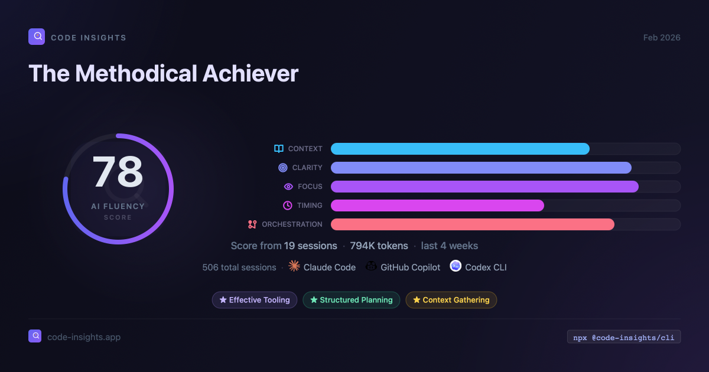
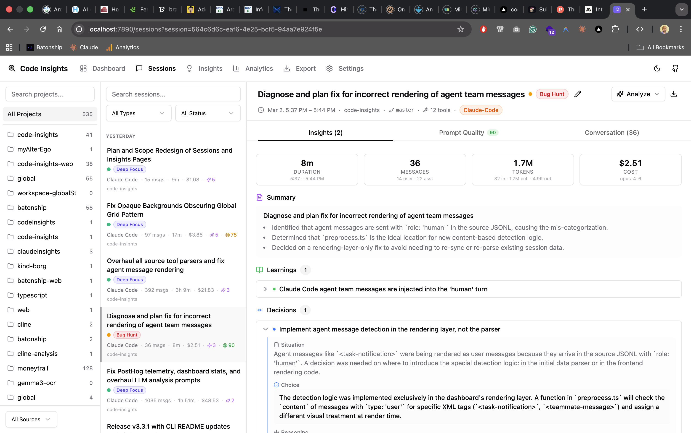
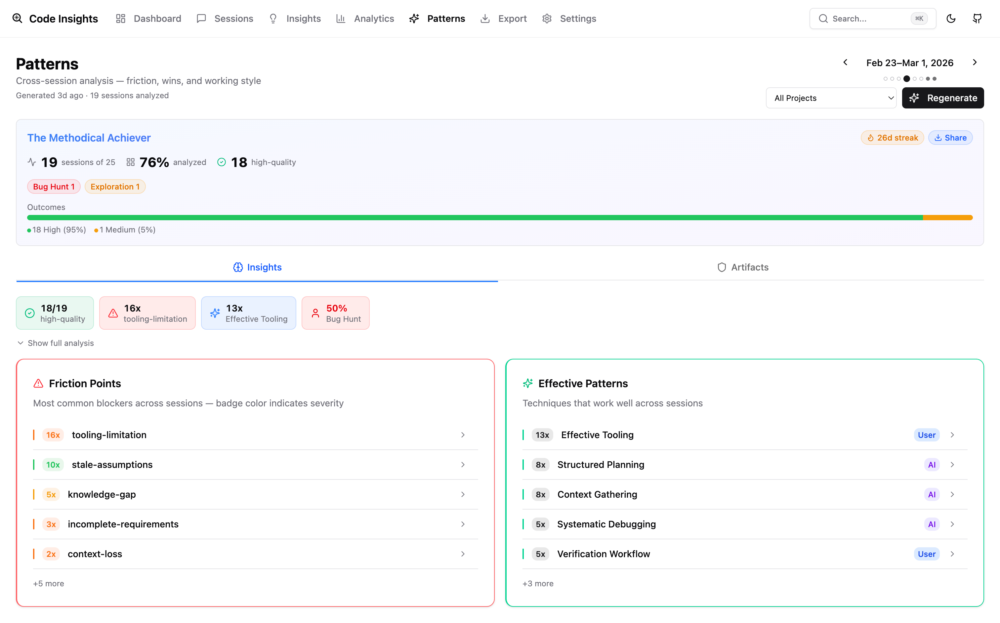
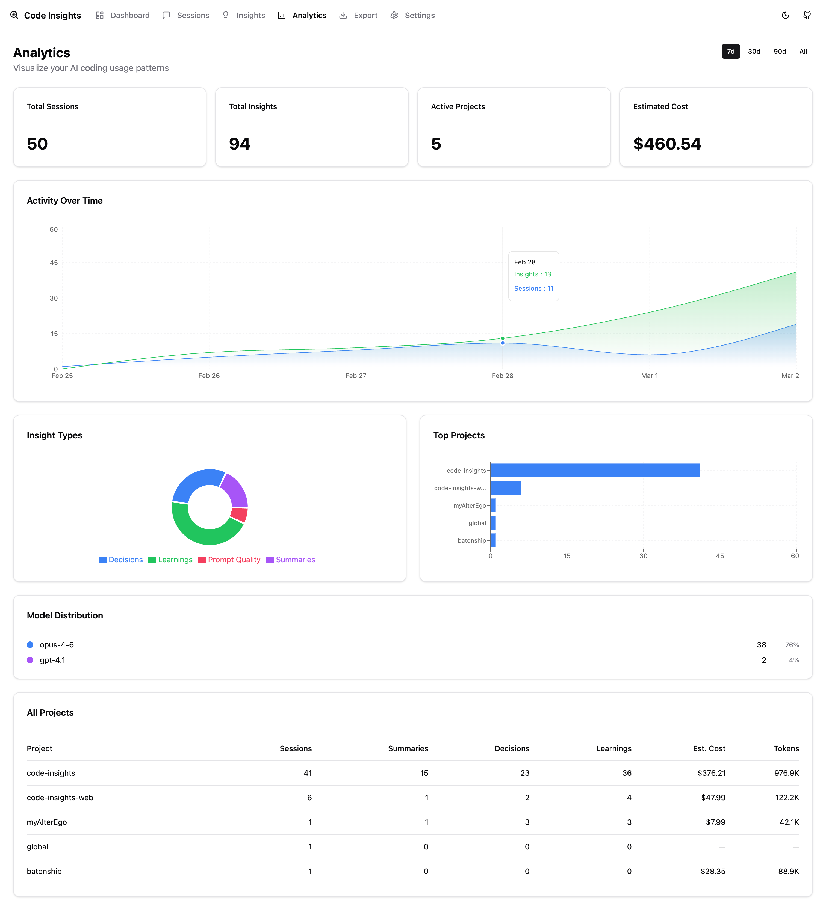
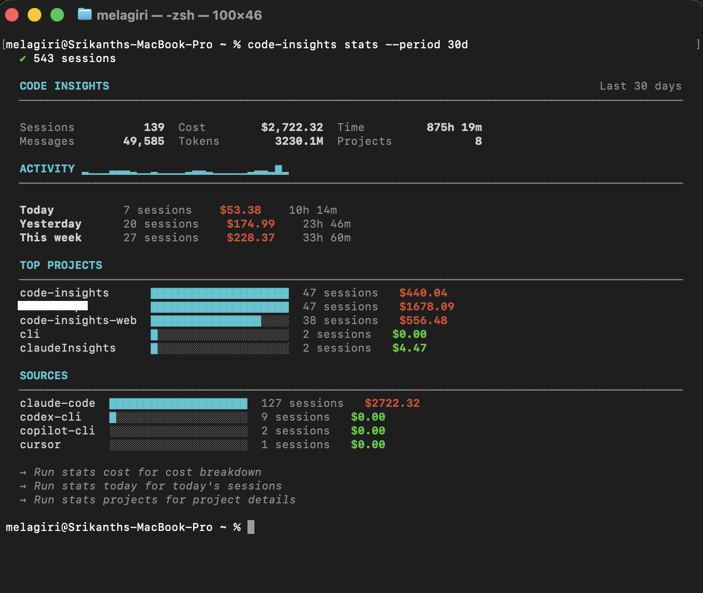

<p align="center">
  
</p>

<h1 align="center">Code Insights CLI</h1>

Extract decisions, learnings, and prompt quality scores from your AI coding sessions. Detect cross-session patterns. Get better at working with AI. Stores structured data in a local SQLite database and serves a built-in browser dashboard with LLM-powered synthesis.

**Local-first. No accounts. No cloud. No data leaves your machine.**

<p align="center">
  
</p>

---

> **Claude Code users: zero-config analysis, zero cost.**
> Install the hook once. Every session gets analyzed automatically using your Claude subscription.
> ```bash
> code-insights install-hook
> ```

---

## Quick Start

```bash
# Try instantly (no install needed)
npx @code-insights/cli

# Or install globally
npm install -g @code-insights/cli
code-insights                          # sync sessions + open dashboard
code-insights install-hook             # auto-sync + auto-analyze on session end
code-insights install-hook --cursor    # auto-sync Cursor transcripts after completed turns
```

The dashboard opens at `http://localhost:7890` and shows your sessions, analytics, and LLM-powered insights.

### Individual commands

```bash
code-insights stats                    # terminal analytics (no dashboard needed)
code-insights stats today              # today's sessions

code-insights dashboard                # start dashboard server (auto-syncs first)
code-insights dashboard --no-sync      # start dashboard without syncing
code-insights sync                     # sync sessions only
code-insights init                     # customize settings (optional)
code-insights doctor                   # diagnose your installation (start here if something's wrong)
```

<p align="center">
  
</p>

## Supported Tools

| Tool | Data Location |
|------|---------------|
| **Claude Code** | `~/.claude/projects/**/*.jsonl` |
| **Cursor** | Agent transcript JSONL (`~/.cursor/projects/*/agent-transcripts/`) + legacy workspace SQLite |
| **Codex CLI** | `~/.codex/sessions/YYYY/MM/DD/rollout-*.jsonl` |
| **Copilot CLI** | `~/.copilot/session-state/{id}/events.jsonl` |
| **VS Code Copilot Chat** | Platform-specific Copilot Chat storage |

Sessions from all tools are discovered automatically during sync.

## Dashboard

```bash
code-insights dashboard
```

Opens the built-in React dashboard at `http://localhost:7890`. The dashboard provides:

- **Session Browser** — global search (`Cmd+K`), advanced filters (date range, outcome, saved presets), soft-delete, and full session details with chat view
- **Analytics** — usage patterns, cost trends, activity charts
- **LLM Insights** — AI-generated summaries, decisions, learnings, and prompt quality analysis (7 deficit + 3 strength categories with dimension scores)
- **Patterns** — weekly cross-session synthesis: friction points (with attribution), effective patterns (with driver classification), working style rules, and shareable AI Fluency Score card (downloadable 1200×630 PNG with score circle, fingerprint bars, and effective patterns)
- **Export** — LLM-powered cross-session synthesis in 4 formats (Agent Rules, Knowledge Brief, Obsidian, Notion)
- **Settings** — configure your LLM provider for analysis

<p align="center">
  
</p>

<p align="center">
  
</p>

### Options

```bash
code-insights dashboard --port 8080    # Custom port
code-insights dashboard --no-open      # Start server without opening browser
```

## CLI Commands

### Setup & Configuration

```bash
# Sync sessions and open dashboard — no setup required
code-insights

# Customize settings (optional) — prompts for Claude dir, excluded projects, etc.
code-insights init

# Show current configuration
code-insights config

# Configure LLM provider for session analysis (interactive)
code-insights config llm

# Configure LLM provider with flags (non-interactive)
code-insights config llm --provider anthropic --model claude-sonnet-4-20250514 --api-key sk-ant-...

# Show current LLM configuration
code-insights config llm --show

# Set a config value (e.g., disable telemetry)
code-insights config set telemetry false
```

### Sync

```bash
# Sync new and modified sessions (incremental)
code-insights sync

# Force re-sync all sessions
code-insights sync --force

# Preview what would be synced (no changes made)
code-insights sync --dry-run

# Sync only from a specific tool
code-insights sync --source cursor
code-insights sync --source claude-code
code-insights sync --source codex-cli
code-insights sync --source copilot-cli

# Sync only sessions from a specific project
code-insights sync --project "my-project"

# Quiet mode (useful for hooks)
code-insights sync -q

# Show diagnostic warnings from providers
code-insights sync --verbose

# Regenerate titles for all sessions
code-insights sync --regenerate-titles

# Soft-delete sessions (preview + confirm)
code-insights sync prune
```

### Terminal Analytics

```bash
# Overview: sessions, cost, activity (last 7 days)
code-insights stats

# Cost breakdown by project and model
code-insights stats cost

# Per-project detail cards
code-insights stats projects

# Today's sessions with time, cost, and model details
code-insights stats today

# Model usage distribution and cost chart
code-insights stats models

# Cross-session patterns summary
code-insights stats patterns
```

<p align="center">
  
</p>

**Shared flags for all `stats` subcommands:**

| Flag | Description |
|------|-------------|
| `--period 7d\|30d\|90d\|all` | Time range (default: `7d`) |
| `--project <name>` | Scope to a specific project (fuzzy matching) |
| `--source <tool>` | Filter by source tool |
| `--no-sync` | Skip auto-sync before displaying stats |

### Reflect & Patterns

Cross-session pattern detection and synthesis. Requires an LLM provider to be configured.

```bash
# Generate weekly cross-session synthesis (current week)
code-insights reflect

# Reflect on a specific ISO week
code-insights reflect --week 2026-W11

# Scope to a specific project
code-insights reflect --project "my-project"

# Backfill facets for sessions that were synced before Reflect existed
code-insights reflect backfill

# Backfill prompt quality analysis
code-insights reflect backfill --prompt-quality
```

The Reflect feature analyzes your sessions to surface:
- **Friction points** — recurring obstacles classified into 9 categories with attribution (user-actionable, AI capability, environmental)
- **Effective patterns** — working strategies across 8 categories with driver classification (user-driven, AI-driven, collaborative)
- **Prompt quality** — how well you communicate with AI tools (7 deficit + 3 strength categories)
- **Working style** — rules and skills derived from your sessions

### Diagnostics

```bash
# Check your installation — environment, database, providers, hooks, LLM, sync state
code-insights doctor

# Show what's wrong and fix it automatically (safe, idempotent fixes only)
code-insights doctor --fix

# Show probed paths for skipped/not-installed items
code-insights doctor --verbose

# Machine-readable output for bug reports
code-insights doctor --json
```

`doctor` checks ~30 things across 8 sections and tells you exactly what to run to fix each issue. If something isn't working, run this first. On a fresh install with no config, it shows a step-by-step setup guide instead of a check list.

### Status & Maintenance

```bash
# Show sync statistics (sessions, projects, last sync)
code-insights status

# Open the local dashboard in your browser
code-insights open
code-insights open --project           # Open filtered to the current project

# Delete all local data and reset sync state
code-insights reset --confirm
```

### Session Analysis

```bash
# Analyze a session using your configured LLM provider
code-insights insights <session_id>

# Analyze using Claude Code (no API key needed — uses your Claude subscription)
code-insights insights <session_id> --native

# Check for unanalyzed sessions (last 7 days)
code-insights insights check

# Batch analyze all unanalyzed sessions
code-insights insights check --analyze

# Custom lookback window
code-insights insights check --days 14
```

### Automatic Hooks

```bash
# Claude Code: auto-sync + auto-analyze when sessions end
code-insights install-hook

# Cursor: auto-sync after each completed Agent turn
# Analysis remains explicit to avoid repeated LLM usage.
code-insights install-hook --cursor

# Remove the Claude Code or Cursor hook
code-insights uninstall-hook
code-insights uninstall-hook --cursor
```

The Cursor hook is stored in `~/.cursor/hooks.json`, preserves unrelated hooks,
and uses Cursor's native `stop` event to sync only the transcript supplied in
the hook payload.

### Telemetry

Anonymous usage telemetry is opt-out. No PII is collected.

```bash
code-insights telemetry status   # Check current status
code-insights telemetry disable  # Disable telemetry
code-insights telemetry enable   # Re-enable telemetry
```

Alternatively, set the environment variable:

```bash
CODE_INSIGHTS_TELEMETRY_DISABLED=1 code-insights sync
```

## LLM Configuration

**Claude Code users don't need to configure anything.** Run `code-insights install-hook` and sessions are analyzed automatically using your Claude subscription.

For other tools, or if you prefer a different model, configure a provider via CLI or the dashboard Settings page:

```bash
code-insights config llm
```

**Supported providers:**

| Provider | Models | Requires API Key |
|----------|--------|-----------------|
| Claude Code (native) | Your Claude subscription model | No (via `install-hook`) |
| Anthropic | claude-opus-4-6, claude-sonnet-4-6, etc. | Yes |
| OpenAI | gpt-4o, gpt-4o-mini, etc. | Yes |
| Google Gemini | gemini-2.0-flash, gemini-2.0-pro, etc. | Yes |
| Ollama | llama3.2, qwen2.5-coder, etc. | No (local) |

API keys are stored in `~/.code-insights/config.json` (mode 0o600, readable only by you).

## Development

This is a pnpm workspace monorepo with three packages: `cli`, `dashboard`, and `server`.

```bash
# Clone
git clone https://github.com/melagiri/code-insights.git
cd code-insights

# Install all dependencies
pnpm install

# Build all packages
pnpm build

# Link CLI for local testing
cd cli && npm link
code-insights --version

# Watch mode (CLI only)
cd cli && pnpm dev
```

### Workspace Structure

```
code-insights/
├── cli/        # This package — Node.js CLI, SQLite, providers
├── dashboard/  # Vite + React SPA
└── server/     # Hono API server (serves dashboard + REST API)
```

### Contributing

See [CONTRIBUTING.md](https://github.com/melagiri/code-insights/blob/master/CONTRIBUTING.md) for code style, PR guidelines, and how to add a new source tool provider.

## Privacy

- All session data is stored in `~/.code-insights/data.db` (SQLite) on your machine
- No cloud accounts required
- No data is transmitted anywhere (unless you explicitly use an LLM provider with a remote API key)
- Anonymous telemetry collects only aggregate usage counts — no session content, no file paths

## License

MIT — see [LICENSE](https://github.com/melagiri/code-insights/blob/master/LICENSE) for details.
